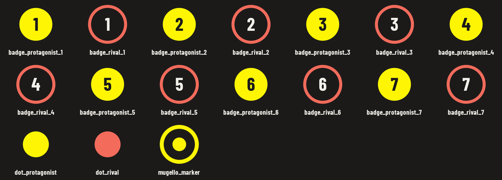

# Tableau build guide: THE ROSSI COMEBACK

A step-by-step guide to building the poster in Tableau Desktop from `data/processed/mugello06.hyper`.
The finished dashboard should match the approved wireframe (`design/wireframe/poster_d.html`,
render `design/wireframe/renders/poster_d.png`), and every rule from `docs/DESIGN_STANDARDS.md`
applies. Work through it one session at a time and check each result before you move on.

**Contents**

0. [The idea: two canvases drawn with map layers](#0-the-idea-two-canvases-drawn-with-map-layers)
1. [The data model](#1-the-data-model)
2. [Session 0: setup and smoke test](#2-session-0-setup-and-smoke-test-do-this-first)
3. [Session 1: data sources](#3-session-1-data-sources)
4. [Session 2: the map canvas](#4-session-2-the-map-canvas)
5. [Session 3: the Italy locator and circuit facts](#5-session-3-the-italy-locator-and-circuit-facts)
6. [Session 4: key numbers](#6-session-4-key-numbers)
7. [Session 5: the race canvas](#7-session-5-the-race-canvas)
8. [Session 6: the dashboard](#8-session-6-the-dashboard)
9. [Session 7: proof and export](#9-session-7-proof-and-export)
10. [Reference: colours, type, shapes, troubleshooting](#10-reference)

**How to read the references.** Names are written the way you'll see them on screen:

- `map_features`, `shape_file`: a table or column as stored in the `.hyper` file. Tableau shows
  columns with capitals and spaces, so `shape_file` appears in the Data pane as **Shape File**.
- **Geo Track**: a field as Tableau shows it in the Data pane (here the column `geo_track`).
  Every map layer has its own ready-made **Geo …** field, so you build layers by dragging, with
  no calculated fields.
- **`Label point`**: a calculated field you create yourself (the name to type is in the code
  font). Only needed for extra layers you invent (§4.5).
- *Marks card › Shape*: a menu or control in Tableau, from the outside in.
- `badge_rival_2.png`: a shape image in `design/tableau/shapes/Mugello 2006/` (§2.2, catalogue
  in §10).
- **Procedure S**: how to put custom shapes on a layer, written once in §2.6 and referred to
  from every layer that uses shapes.

---

## 0. The idea: two canvases drawn with map layers

The two busiest parts of the poster are the **map** and the **race band**. Each one stacks
many kinds of marks: lines, dots, badges, labels. A normal Tableau chart gives you at most two
mark layers (a dual axis). A **map** gives you as many as you like (**Map Layers**,
Tableau 2020.4 and later), each with its own mark type, colour, size and label settings, all
locked to the same coordinates.

The catch is that map layers only work on geography, and both canvases are flat drawings:
the circuit in the TV orientation (north pointing left) and the race chart in poster pixels.
So the pipeline turns each drawing into **fake geography**:

- the drawing is placed on the equator at 0°, 0°;
- its x becomes longitude and its y becomes latitude, through the inverse of the Web Mercator
  projection that Tableau's maps use. When Tableau projects the shapes back, they land exactly
  where they were drawn, at one uniform scale.

You switch the base map off, and what's left is our drawing on a plain background. Every
canvas is one table, and **each map layer has its own spatial column**: `geo_track` holds the
circuit, `geo_stretch` the yellow stretches, `geo_start_line` the green start line,
`geo_corner_label_left` the corner names that sit left of their corner, and so on. A row fills
only the column of its own layer and leaves the others empty. So one drag of **Geo Track**
draws the circuit and nothing else; you never set up paths or point orders.

There's deliberately **no** all-in-one geometry field. Dragging one field with every layer in
it puts the lines, labels' anchor points and badges into a single layer with one style, which
isn't what we want.

There's a bonus: a map always keeps one unit the same length across and up, so the circuit
can't be squashed by mistake.

**Marks with more than one colour are images.** A Tableau mark has one colour, and a shape
mark has no border. So the numbered badges (a yellow disc with a dark number, or a dark disc
with a coral ring), the rider dots (with their dark ring) and the Mugello marker (a ring around
a dot) are **custom shapes**: PNG images that carry their own colours. Each row that uses one
has a `shape_file` column whose value is the image's file name (`badge_protagonist_4`), so you
always know which image goes where.

| Canvas | Table | Units | Tableau sheet size |
|---|---|---|---|
| Map | `map_features` | metres, TV orientation | **1328 × 992 px** |
| Race band (chart, moment lines, badges, footer key) | `race_features` | poster px | **1728 × 560 px** |

Each table has a `frame` layer: four invisible corner points with the **same aspect ratio as
the sheet**. Tableau zooms to fit what it draws, so the frame fixes the zoom. The canvas then
fills the sheet edge to edge, and one pixel of the sheet is one pixel of the poster.

## 1. The data model

The `.hyper` file holds 11 tables, all built and tested by the pipeline (`uv run mugello06 all`).
Tableau only draws: every number, position and label is computed upstream.

### Tables

| Table | Grain (one row per…) | Key | Used by |
|---|---|---|---|
| `map_features` | map layer item | `layer` + `item` | **Map** sheet: all its layers |
| `race_features` | race band layer item | `layer` + `item` | **Race** sheet: all its layers |
| `locator_features` | Italy polygon, plus the Mugello point | `layer` + `polygon_id` | **Locator** sheet |
| `key_numbers` | key number (3) | `moment_id` | **Key numbers** sheet |
| `event` | the event (1 row) | none | **Circuit facts** sheet |
| `key_moments` | story moment (7) | `moment_id` | **Moment card** text (headline, story, lap); reference |
| `riders` | rider (19) | `rider_number` | reference (names, roles, `in_chart`) |
| `positions` | rider × lap, lap 0 = grid (425) | `rider_number` + `lap` | reference (raw positions behind the race canvas) |
| `timeline` | lap (23) | `lap` | reference (leader, gap between Rossi and Capirossi) |
| `track` | outline point (129) | `point_idx` | reference (circuit points behind the map canvas) |
| `track_stretches` | point of a yellow stretch | `stretch_id` + `seq` | reference |

"Reference" tables aren't drawn directly. They're the building blocks of the canvases, and
they're useful for checking a value or exploring the race in Tableau.

### Columns you'll use

**`map_features` and `race_features`** (same shape):

| Column | Meaning |
|---|---|
| `layer` | what the row draws: `frame`, `track`, `stretch`, `badge`… (lists in sessions 2 and 5) |
| `align` | for text layers, Tableau's horizontal label alignment: `left`, `center` or `right` |
| `item` | readable name of the row (`San Donato`, `moment 4`, `finish Rossi`…) |
| `moment_id` | the story moment (1–7), on moment rows |
| `role` | `protagonist` (Rossi), `rival` (Capirossi) or `other`: drives the colour |
| `label` | the text to show on the mark (corner names, badge numbers, callouts…) |
| `shape_file` | on `badge` and `rider_dot` rows only: the custom shape to show, e.g. `badge_rival_2` = `badge_rival_2.png` (empty on every other row) |
| `x_m`/`y_m` or `x_px`/`y_px` | canvas position of point rows, for checking only |
| `tableau_layer` | the Tableau map layer the row belongs to, e.g. `corner_label_left`; the row's shape is in the column `geo_` + this name |
| `lat`, `lon` | on point rows: the point as (fake) latitude and longitude, for `MAKEPOINT([Lat], [Lon])` (§4.5) |
| `geo_<layer>` | **one spatial column per map layer** (lists in §4.1 and §7.1), filled only on that layer's rows. In Tableau: **Geo Track**, **Geo Badge**… |
| `wkt` | the same shape as text, for checking only (not spatial) |

**`locator_features`**: `layer` (`italy` or `mugello`), `label`, `polygon_id`, `shape_file`
(`mugello_marker` on the Mugello row), `geo_italy` and `geo_mugello` (real longitude/latitude,
north-up), `wkt`.

**`key_numbers`**: `rank` (race order 1–3), `moment_id`, `lap`, `rider_role`, `shape_file`
(`badge_protagonist_4`, `_6`, `_7`), `value_s`,
`value_text` (e.g. `0.730 s`), `label` (e.g. `Rossi's winning margin`).

**`key_moments`**: `moment_id`, `lap`, `headline`, `story`, `rider_role`, `rider_display_name`,
`rider_position` (where that rider was that lap: the race connector ends there), `card_side`
(`above`/`below` the chart), `on_map`, `corner_name`.

**`event`**: `event_name`, `race_date`, `race_laps`, `race_distance_km`, `track_length_m`,
`track_width_m`, `corners`, `right_corners`, `left_corners`, `longest_straight_m`, `constructed`,
`condition`, `air_c`, `track_c`, `circuit_name`, `circuit_town`.

### Tableau data sources

Use **separate data sources**, one per job. The canvases are single tables on purpose: map
layers must come from one data source, and a single table can't duplicate rows through a join.

| Data source | Tables (relationships) | Feeds |
|---|---|---|
| **Map canvas** | `map_features` | Map |
| **Race canvas** | `race_features` | Race |
| **Locator** | `locator_features` | Locator |
| **Key numbers** | `key_numbers` | Key numbers |
| **Event** | `event` | Circuit facts |
| **Race data** (reference) | `positions` → `riders` on `rider_number`; `positions` → `timeline` on `lap`; `timeline` → `key_moments` on `lap` | checking, and copying the card text |
| **Track** (reference) | `track` → `track_stretches` on `point_idx` | checking only |

```
Race data (reference)                          Track (reference)

riders ──rider_number── positions              track ──point_idx── track_stretches
                           │
                          lap
                           │
                        timeline ──lap── key_moments
```

## 2. Session 0: setup and smoke test (do this first)

A short session that settles the things a guide can't promise, before any real building.

### 2.1 Install the fonts

1. Download **Barlow** and **Barlow Condensed** from Google Fonts (SIL Open Font License).
2. Install these styles **for all users** (right-click the file › *Install for all users*):
   - Barlow: Regular, Medium, SemiBold;
   - Barlow Condensed: Medium, SemiBold, Bold, ExtraBold Italic.
3. Restart Tableau Desktop. In any text box, the font list should now show Barlow and Barlow
   Condensed. (Tableau lists them as families, e.g. *Barlow Condensed SemiBold*.)

### 2.2 Install the custom shapes

The 17 shape images are committed in **`design/tableau/shapes/Mugello 2006/`** (preview and
list in §10, *Shape catalogue*). Tableau reads shapes from its repository folder, and each
sub-folder becomes a *shape palette* with the folder's name.

1. Close Tableau Desktop.
2. Open `Documents\My Tableau Repository\Shapes\` (Tableau creates it on first run; if you use
   OneDrive, it may be `OneDrive\Documents\My Tableau Repository\Shapes\`).
3. Copy the whole folder **`Mugello 2006`** into it, so you end up with
   `…\My Tableau Repository\Shapes\Mugello 2006\badge_protagonist_1.png` and so on.
4. Open Tableau again. The palette **Mugello 2006** now appears in every *Edit Shape* dialog.

If the shapes ever change (`uv run python design/tableau/tools/make_shapes.py` rewrites them),
copy the folder again and click **Reload Shapes** in the *Edit Shape* dialog.

### 2.3 Refresh the data

```bash
uv run mugello06 all     # writes data/processed/mugello06.hyper
```

### 2.4 Smoke test: the fake-geography map

1. **Connect › To a File › More…** and open `data/processed/mugello06.hyper`.
2. Drag **map_features** onto the canvas, **and nothing else**: the data source must hold only
   this table. (If another table is in it, e.g. `locator_features` with the real Italy,
   Tableau can zoom out to fit both, and the circuit shrinks to a few dots.) Go to a new sheet.
3. Double-click **Geo Track**. Tableau puts *Longitude (generated)* on Columns,
   *Latitude (generated)* on Rows and *COLLECT(Geo Track)* on Detail. You should see the
   circuit as one white line, with the main straight running across, on top of a world map
   near Africa.
4. **Map › Background Maps › None.** The world disappears and only the circuit stays.
5. Drag **Geo Frame** onto the view and drop it on **Add a Marks Layer**. The frame is four
   points just outside the circuit; the view zooms to fit them.

✅ **Pass:** the circuit looks like the poster (San Donato on the left, Arrabbiata on the right)
and fills the sheet, with four frame dots at the corners.

If the circuit still shrinks to dots: check the *Marks* card (only *Geo Track* and *Geo Frame*
should be layers) and the data source (only `map_features`), then tell Claude what you see.

### 2.5 Smoke test: zoom, fonts and export

1. **Map › Map Options…**: untick *Allow users to pan and zoom*, *Show map search*,
   *Show view toolbar* and *Show map scale*.
2. New dashboard. **Size › Fixed size › Custom: 1920 × 2108.**
3. Drag the sheet in as **Floating**. In the *Layout* pane set **x 296, y 412, w 1328, h 992**.
4. Add a floating **Image** object at x 0, y 0, w 1920, h 2108 with
   `design/wireframe/renders/poster_d_overlay.png` (*Fit image*). Send it to the back
   (it should sit at the bottom of the floating items in the *Layout* pane).
5. Make the sheet transparent: on the sheet, **Format › Shading**, set *Worksheet* and *Pane*
   to **None**. Then, in the dashboard, select the sheet and set its *Background* to **None**.
6. Check that the white track in Tableau sits **on** the track of the overlay image.

✅ **Pass:** the two tracks overlap within a few pixels. If Tableau leaves a margin around the
frame, see *Troubleshooting* at the end.

7. Add a floating **Text** object with *Lap 23* in **Barlow Condensed Medium 10.5 pt** and
   place it on the overlay's *Lap 23* (x ≈ 1544, y ≈ 1764). It should be the same size.
   That confirms the rule **Tableau pt = wireframe px × 0.75**, used throughout this guide.
8. **File › Print to PDF…** (*Entire workbook* off, *Selection*: this dashboard). Under
   *Paper size*, choose **Unspecified**, so the page takes the dashboard's own size. Open the
   PDF and zoom to 800 %: lines and text should stay sharp, because they're vector.

✅ **Pass:** the PDF is one page with the dashboard's proportions (1920 : 2108 = 120 : 131.75 cm),
and it stays sharp when zoomed.

### 2.6 Smoke test: custom shapes (and Procedure S)

This section is also the reference for **Procedure S**, used by every badge, dot and marker
layer later on.

**Procedure S: put custom shapes on a layer**

1. On the *Marks* card, pick the layer (its tab, named after its field, e.g. *Geo Badge*).
2. Open the mark-type dropdown (it says *Automatic* or *Circle*) and choose **Shape**. A
   **Shape** button appears on the card, next to *Color*, *Size* and *Label*.
3. Drag the field **Shape File** from the Data pane onto that **Shape** button. A shape legend
   opens, listing each value (e.g. `badge_protagonist_1`).
4. Click the **Shape** button › **More Shapes…** (or, on the legend's menu ▾, **Edit Shape…**).
   The *Edit Shape* dialog opens: data items on the left, shapes on the right.
5. Under *Select Shape Palette*, choose **Mugello 2006**.
6. Click the first data item on the left, then click the shape with **the same name** on the
   right. The images show their number and colour, so `badge_rival_2` is the dark disc with a
   coral ring and a 2. Repeat for every item. Don't use *Assign Palette*: it hands out the
   shapes in palette order, not by name, so the numbers would be wrong.
7. Click **OK**. Leave **Color** empty on this layer (no field on it): the image brings its own
   colours. Set *Color › Opacity* to **100 %**.
8. Set *Size* (the slider) so the shape's outer diameter matches the overlay (sizes in the
   §10 *Shape catalogue*). Tableau scales the whole image, and every image is a full-width
   circle, so all badges in one layer come out the same size.

A data item named *Null* may appear in the list (rows from other layers). Leave it alone: those
rows have no geometry on this layer, so nothing is drawn for them.

**The smoke test**

1. On the smoke-test sheet (map_features, §2.4), drag **Geo Badge** onto the view and drop it
   on **Add a Marks Layer**.
2. Follow **Procedure S** for this layer.
3. Check the dashboard: five yellow badges with dark numbers 1, 4, 5, 6, 7 sit on the overlay's
   badges by the start line (① ⑥), San Donato (④ ⑦) and Arrabbiata 1 (⑤).
4. Print to PDF again (as in §2.5, step 8) and zoom to 800 % on a badge.

✅ **Pass:** the badges keep their own colours (yellow disc, dark number), not one flat colour,
and stay smooth at 800 % zoom (they're 512 px images; printed at about 1.7 cm, that's over
700 dpi). They're images, so they're the only marks that are pixels instead of vectors in the
PDF; that's fine at this resolution. If a badge comes out as a one-colour silhouette, see
*Troubleshooting › Shapes come out in one colour*.

> If any check fails, stop and report it before building more. Each one has a fallback
> (*Troubleshooting*), and it's cheaper to switch now.

Delete the test dashboard and sheet afterwards, but keep the connection.

## 3. Session 1: data sources

Create each data source from the same `.hyper` file (**Data › New Data Source** › the file).
Rename each one (right-click › *Rename*) as in §1.

1. **Map canvas**: drag `map_features` onto the canvas.
2. **Race canvas**: `race_features`.
3. **Locator**: `locator_features`.
4. **Key numbers**: `key_numbers`.
5. **Event**: `event`.
6. **Race data**: drag `positions`, then `riders` next to it. Tableau proposes a relationship:
   set it to `rider_number = rider_number`. Drag `timeline` and relate it to `positions` on
   `lap = lap`. Drag `key_moments` and relate it to `timeline` on `lap = lap`.
7. **Track**: `track`, then `track_stretches` on `point_idx = point_idx`.

In each data source, check the field types. Every **Geo …** field should show the globe icon
(spatial), and **Wkt** should be text;
**Shape File** should be a text dimension (*Abc*); `lap`, `rank` and `moment_id` should be
numbers. Turn `moment_id`, `rank` and `lap` into
**dimensions** (drag them above the line in the Data pane), because they're labels, not
quantities.

Save the workbook as **`design/tableau/mugello06.twb`**. Only `.twb` files are committed;
packaged `.twbx` files and the `.hyper` stay local.

## 4. Session 2: the map canvas

Sheet name: **Map**. Data source: **Map canvas**.

### 4.1 The layers and their fields

Each row of this table is one map layer, listed **bottom to top** (the order you add them).
The field is ready-made in the *Map canvas* data source: no calculated fields.

| # | Layer | Field to drag | What it draws | Rows |
|---|---|---|---|---|
| 1 | Frame | **Geo Frame** | 4 invisible corner points that fix the zoom | 4 |
| 2 | **Circuit** (the main layer) | **Geo Track** | the circuit outline, one closed white line | 1 |
| 3 | Highlights | **Geo Stretch** | the three yellow stretches where the moments happened | 3 |
| 4 | Start line | **Geo Start Line** | the green start/finish line across the track | 1 |
| 5 | Leaders | **Geo Leader** | thin lines from a corner out to its badge | 5 |
| 6 | Corner dots | **Geo Corner Dot** | a small dot on each named corner | 15 |
| 7 | Corner names, left | **Geo Corner Label Left** | names that end at their point (e.g. *San Donato*) | 6 |
| 8 | Corner names, centre | **Geo Corner Label Center** | names centred on their point (e.g. *Luco*) | 2 |
| 9 | Corner names, right | **Geo Corner Label Right** | names that start at their point (e.g. *Casanova*) | 8 |
| 10 | Badges | **Geo Badge** | the numbered badges ① ④ ⑤ ⑥ ⑦ (custom shapes) | 5 |
| 11 | Callouts, left | **Geo Callout Left** | callout text ending left of its badges | 2 |
| 12 | Callouts, right | **Geo Callout Right** | callout text starting right of its badges | 3 |

Why are the labels split by alignment? In Tableau, alignment is set per layer, not per mark,
and the names need three alignments. Each label row is one point (where the text is anchored),
already offset from its corner as in the wireframe, so you never place a label by hand.

### 4.2 Build the layers

1. Double-click **Geo Frame**. It becomes the first layer. **Map › Background Maps › None.**
2. Drag **Geo Track** onto the view and drop it on the **Add a Marks Layer** box that appears
   at the top-left of the map.
3. Repeat for every other field in the table above, **in its order** (3 to 12). On the
   *Marks* card, the **top** layer draws on top; drag layers to reorder them if needed.
4. Each layer shows a small *N nulls* indicator at the bottom-right (the rows that belong to
   other layers, where this field is empty). Right-click it › **Hide indicator**.
5. **Map › Map Options…**: untick everything (pan and zoom, search, toolbar, scale).

### 4.3 Style each layer

Use **Color › More colors…** to type the hex values. Sizes are relative in Tableau: set them
against the overlay in the dashboard (§8) until they match the widths below.

| Layer (field) | Mark | Colour | Size / width | Label |
|---|---|---|---|---|
| Frame (**Geo Frame**) | Circle | any | smallest | **opacity 0 %** (invisible) |
| Circuit (**Geo Track**) | Line (automatic) | `#F2EFE9` ink | ≈ 7 px | none |
| Highlights (**Geo Stretch**) | Line | `#FDF504` Rossi yellow | ≈ 9 px (wider than the track) | none |
| Start line (**Geo Start Line**) | Line | `#229457` green | ≈ 6 px | none |
| Leaders (**Geo Leader**) | Line | `#A8A29A` muted | thinnest (1 px) | none |
| Corner dots (**Geo Corner Dot**) | Circle | `#A8A29A` | ≈ 5 px | none |
| Corner names ×3 (**Geo Corner Label Left / Center / Right**) | Circle | any, **opacity 0 %** | smallest | `label`, Barlow Condensed Medium 10.5 pt, `#A8A29A` |
| Badges (**Geo Badge**) | **Shape**: **Shape File** on *Shape*, palette *Mugello 2006* (**Procedure S**, §2.6) | none (the image has its colours) | **28 px** across | none: the number is part of the image |
| Callouts ×2 (**Geo Callout Left / Right**) | Circle | any, **opacity 0 %** | smallest | `label`, Barlow Condensed SemiBold 12.8 pt, `#F2EFE9` |

Badge shapes on this sheet (all five are Rossi's moments):

| Shape File value | Image | Where it lands |
|---|---|---|
| `badge_protagonist_1` | yellow 1 | by the start line (with ⑥ next to it) |
| `badge_protagonist_4` | yellow 4 | San Donato (with ⑦ next to it) |
| `badge_protagonist_5` | yellow 5 | Arrabbiata 1 |
| `badge_protagonist_6` | yellow 6 | 30 px right of ① |
| `badge_protagonist_7` | yellow 7 | 30 px right of ④ |

On the **label** layers (corner labels and callouts):

1. Drag **Label** (`label`) onto *Label*.
2. Click *Label* › **Alignment**:
   - *Geo Corner Label Left* and *Geo Callout Left*: Horizontal **Left** (the text ends at the point);
   - *Geo Corner Label Center*: Horizontal **Center**;
   - *Geo Corner Label Right* and *Geo Callout Right*: Horizontal **Right** (the text starts at the point);
   - Use Vertical **Middle** everywhere: the pipeline puts each label point on the middle of
     the text line.
3. Tick **Allow labels to overlap other marks**, otherwise Tableau hides labels that touch
   a line.
4. On *Geo Callout Left*, `1 · Rossi leads at home` should end just left of badges ① and ⑥.

The opacity-0 trick shows only the text: the circle is invisible but still carries the label.

All badges on the map are Rossi's moments (①④⑤⑥⑦). Moments ② and ③ are Capirossi's and
happen along the race, not at one corner, so they appear only on the race band (session 5).

### 4.4 Sheet formatting

- **Format › Shading**: *Worksheet* and *Pane* **None** (transparent), so the dashboard's
  `#1C1A19` shows through.
- **Format › Borders / Lines**: all **None**.
- **Worksheet › Tooltip…**: untick *Show tooltips*.
- Hide the sheet title (**Worksheet › Show Title** off).

✅ **Check:** the sheet matches `design/tableau/previews/map_canvas.png` (drawn from the same
data by `design/tableau/tools/preview_canvas.py`) and the map in the wireframe:
3 yellow stretches, 15 corner dots, 16 names, 5 badges with leader lines and 5 callouts.

### 4.5 Your own extra layers (MAKEPOINT)

The twelve fields cover the whole design. If you want another layer while you experiment,
build it from the `lat`/`lon` columns, which every **point** row has (corner dots, label
points, badges, frame corners). They're the same fake coordinates as the **Geo …** fields, so
anything you make lands exactly on the drawing.

Example: a layer that writes each corner's name right on its dot (handy for checking).

1. **Analysis › Create Calculated Field…**, name `Label point`:
   ```
   IF [Layer] = 'corner_dot' THEN MAKEPOINT([Lat], [Lon]) END
   ```
   (`MAKEPOINT` takes **latitude first**, then longitude.)
2. Drag `Label point` onto **Add a Marks Layer**, set the mark to *Circle*, opacity 0 %, and put
   **Item** (the corner name) on *Label*.

Change the `IF` test to pick other rows: `[Tableau Layer] = 'badge'`, `[Item] = 'San Donato'`,
`[Moment Id] = 4`… A line works the same way with
`MAKELINE(MAKEPOINT([Lat], [Lon]), MAKEPOINT(…))`.

For anything that should stay on the poster, ask Claude to add it to the pipeline instead
(as a new `geo_…` column, with its position taken from the wireframe), so it's tested and
documented like the rest.

## 5. Session 3: the Italy locator and circuit facts

### 5.1 Locator (real geography)

Sheet **Locator**, data source **Locator**.

Two layers, two ready-made fields: **Geo Italy** (the land) and **Geo Mugello** (the marker).

1. *(No calculated fields.)*
2. Double-click **Geo Italy**. Put **Polygon Id** on *Detail* so each land mass is its own shape.
   **Map › Background Maps › None.** Fill `#2A2725`, border `#A8A29A` (*Color › Border*).
3. Drag **Geo Mugello** onto **Add a Marks Layer**. Follow **Procedure S** (§2.6): **Shape File** on
   *Shape*, and give the one item, `mugello_marker`, the shape `mugello_marker.png` (a yellow
   ring around a yellow dot). Size: **20 px** across.
4. On the same layer, put *Label* (`Mugello`) on *Label*: Barlow Condensed SemiBold 12.8 pt,
   `#F2EFE9`, Horizontal **Right**, Vertical **Middle**.
5. Map Options: untick everything. Shading None, tooltips off, title off.

This map is north-up on purpose: it's a real map of Italy.

### 5.2 Circuit facts (text)

Sheet **Circuit facts**, data source **Event**. Mark type **Text**. Put every field you need on
*Detail* (or on *Text*), then click *Text* › **…** and write the label. Insert the fields with
*Insert ▸*:

```
<Circuit Name>
<Circuit Town>, Tuscany
Built <Constructed> · <Track Length M> m · <Track Width M> m wide
<Corners> corners: <Right Corners> right, <Left Corners> left
Longest straight <Longest Straight M> m
Race: <Race Laps> laps · <Race Distance Km> km
<Condition> · air <Air C> °C · track <Track C> °C
```

- Line 1: Barlow Condensed SemiBold 14.2 pt, `#F2EFE9`. If the circuit name doesn't wrap after
  *Internazionale* in the 264 px column, type it as two lines (*Autodromo Internazionale* /
  *del Mugello*).
- Other lines: Barlow Regular 11.2 pt, `#A8A29A`. Alignment left.
- Number formats (right-click the field on the shelf › *Format…*): `Track Length M` and
  `Longest Straight M` as Number with a thousands separator (5,245 and 1,141); `Race Distance Km`
  with **1 decimal** (120.6); `Constructed` as Number with **no** separator (1974).
- Shading None, title off, tooltips off.

## 6. Session 4: key numbers

Sheet **Key numbers**, data source **Key numbers**: three rows, each a badge, then the value
with its label.

1. Put **Rank** (dimension) on *Rows*. Right-click it › untick **Show Header**.
2. Create `Zero` = `0`. Put it on *Columns* twice. Right-click the second › **Dual Axis**, then
   **Synchronize Axis**. Hide both axes (right-click › untick *Show Header*).
3. Fix the axis range at **−0.1 to 1** (*Edit Axis* › *Fixed*). The badges then sit at the left
   edge, and the text has room to the right.
4. **First marks card (badge):** follow **Procedure S** (§2.6) on this card: mark type
   **Shape**, **Shape File** on *Shape*, palette *Mugello 2006*. The three items are
   `badge_protagonist_4`, `badge_protagonist_6` and `badge_protagonist_7`; give each the image
   with the same name. Size: **22 px** across. No label: the number is in the image.
5. **Second marks card (text):** Circle, **opacity 0 %**. Put *Value Text* and *Label* on
   *Label* and edit it to:
   ```
   <Value Text>
   <Label>
   ```
   *Value Text*: Barlow SemiBold 34.5 pt, `#F2EFE9`. *Label*: Barlow Regular 12 pt, `#A8A29A`.
   Alignment Horizontal **Right**, Vertical **Middle**. Tick *Allow labels to overlap*.
6. **Format › Borders**: row dividers None. Shading None, title and tooltips off.
7. Sort *Rank* ascending: 0.730 s (④), 0.002 s (⑥), 0.575 s (⑦), in race order.

In the dashboard, size each row so the value's baseline lands on the overlay's (rows are
104 px apart in the wireframe).

## 7. Session 5: the race canvas

Sheet **Race**, data source **Race canvas**. The same technique as the map, in poster pixels.

### 7.1 The layers and their fields

Bottom to top, each with its ready-made field in the *Race canvas* data source:

| # | Layer | Field to drag | What it draws | Rows |
|---|---|---|---|---|
| 1 | Frame | **Geo Frame** | 4 invisible corner points that fix the zoom | 4 |
| 2 | Axis | **Geo Axis** | the lap axis and its 24 ticks | 25 |
| 3 | Connector | **Geo Connector** | the vertical moment lines, badge to rider | 7 |
| 4 | Lines back | **Geo Lines Back** | the 4 grey riders and Capirossi | 5 |
| 5 | Halo | **Geo Halo** | a background-coloured band under Rossi's line | 1 |
| 6 | Line Rossi | **Geo Line Rossi** | Rossi's line | 1 |
| 7 | Rider dot | **Geo Rider Dot** | where the rider was at each moment, plus the two finishes (custom shapes) | 9 |
| 8 | Badge | **Geo Badge** | the 7 moment badges (custom shapes) | 7 |
| 9 | Key badge | **Geo Key Badge** | the two badges in the footer key (custom shapes) | 2 |
| 10 | Axis label left | **Geo Axis Label Left** | *Grid*, *1st*, *4th*, *8th* | 4 |
| 11 | Axis label center | **Geo Axis Label Center** | *Lap 23* | 1 |
| 12 | End label | **Geo End Label** | *Rossi · 1st*, *Capirossi · 2nd* | 2 |
| 13 | Key line | **Geo Key Line** | the yellow "where it happened" sample | 1 |
| 14 | Key label | **Geo Key Label** | the footer key's three texts | 3 |

The moment badges and the two footer-key badges are separate layers only because they're
different sizes (26 px and 22 px across, as in the wireframe); a layer has one size.

### 7.2 Layers, bottom to top, and their style

Build them as in §4.2: double-click **Geo Frame**, set **Background Maps › None**, then add each
field as a marks layer in this order:

| Layer | Mark | Colour | Size | Label / notes |
|---|---|---|---|---|
| Frame | Circle | any | smallest | opacity 0 % |
| Axis | Line | `#A8A29A` | 1 px | the axis line and the 24 lap ticks |
| Connector | Line | **Role** on *Color*: protagonist `#FDF504`, rival `#F26B5B` | 1.5 px, opacity 85 % | moment lines from the badge to the rider (under the riders' lines) |
| Lines back | Line | **Role** on *Color*: other `#6F6A64`, rival `#F26B5B` | other 1.5 px, Capirossi 3 px (**Role** on *Size*) | 4 grey riders + Capirossi |
| Halo | Line | `#1C1A19` (background) | ≈ 7 px | makes Rossi's line read as on top where lines cross |
| Line Rossi | Line | `#FDF504` | ≈ 4 px (the thickest rider line) | |
| Rider dot | **Shape** (**Procedure S**): **Shape File** on *Shape* | none (in the image) | **12 px** across | `dot_protagonist` (yellow) and `dot_rival` (coral), each with a dark ring that separates it from the lines: where the rider was at each moment, plus Rossi and Capirossi at the finish |
| Badge | **Shape** (**Procedure S**): **Shape File** on *Shape* | none (in the image) | **26 px** across | the 7 moment badges; no label, the number is in the image |
| Key badge | **Shape** (**Procedure S**): **Shape File** on *Shape* | none (in the image) | **22 px** across | the two badges in the footer key: `badge_protagonist_4` (*Rossi moment*) and `badge_rival_2` (*Capirossi moment*) |
| Axis label left | Circle, opacity 0 % | | smallest | `label` (Grid, 1st, 4th, 8th): Barlow Condensed Medium 10.5 pt, `#A8A29A`, Horizontal **Left** |
| Axis label center | Circle, opacity 0 % | | smallest | `Lap 23`, same font, **Center** |
| End label | Circle, opacity 0 % | | smallest | `Rossi · 1st`, `Capirossi · 2nd`: Barlow Condensed SemiBold 11.2 pt, `#F2EFE9`, **Right** |
| Key line | Line | `#FDF504` | ≈ 6 px | the "where it happened" sample in the footer key |
| Key label | Circle, opacity 0 % | | smallest | Barlow Regular 10.5 pt, `#A8A29A`, **Right** |

For every label layer: Vertical **Middle**, and tick **Allow labels to overlap other marks**.
Hide all *nulls* indicators, untick everything in Map Options, and set shading None. Tooltips
and title off.

Shape assignments on this sheet (Procedure S, step 6). Each layer lists only its own items:

| Layer | Shape File value | Image | Rows |
|---|---|---|---|
| Rider dot | `dot_protagonist` | yellow dot, dark ring | Rossi at moments ①④⑤⑥⑦ and at the finish |
| Rider dot | `dot_rival` | coral dot, dark ring | Capirossi at moments ②③ and at the finish |
| Badge | `badge_protagonist_1`, `_4`, `_5`, `_6`, `_7` | yellow disc, dark number | moments ①④⑤⑥⑦ |
| Badge | `badge_rival_2`, `badge_rival_3` | dark disc, coral ring, light number | moments ②③ |
| Key badge | `badge_protagonist_4` | yellow 4 | footer key, *Rossi moment* |
| Key badge | `badge_rival_2` | coral-ringed 2 | footer key, *Capirossi moment* |

The palette also holds `badge_rival_1`, `_4` … `_7`. Nothing uses them today; they're there so
every number exists in both styles if a moment ever changes rider.

✅ **Check:** the sheet matches `design/tableau/previews/race_canvas.png`: 6 rider lines (Rossi on top), 7 vertical moment lines, each ending on a dot on its
rider's line (② on Capirossi in 7th at lap 7; ③ on Capirossi in 3rd at lap 13), 7 numbered
badges at the top and bottom edges, and the key at the bottom-left.

## 8. Session 6: the dashboard

### 8.1 Canvas

- New dashboard **Poster**. **Size › Fixed size › Custom: 1920 × 2108** px.
  This is the wireframe's 4 px grid at 1.6 px/mm; it prints at 120 × 131.75 cm.
- **Format › Dashboard › Dashboard shading**: `#1C1A19`.
- Make **every** object **Floating**, and type positions in the *Layout* pane. Every value
  below comes from the wireframe, so it sits on the 4 px grid.
- For each sheet: background None, outer and inner padding 0, borders None, title hidden.
- First add the **overlay** (`design/wireframe/renders/poster_d_overlay.png`, x 0, y 0,
  w 1920, h 2108) at the **back**, to align against. Delete it before exporting.

### 8.2 Object positions

`x, y` is the top-left corner. Text objects show their target **baseline** too: Tableau places
text by its box, so nudge the box until the baseline sits on the overlay's.

| Object | Type | x | y | w | h | Notes |
|---|---|---|---|---|---|---|
| Kicker *MUGELLO 2006* | Text | 96 | 92 | 400 | 36 | baseline 120 · Barlow Condensed ExtraBold Italic 22.5 pt `#F2EFE9` |
| Livery flash | Image `design/tableau/assets/livery_flash.png` | ≈ 276 | 96 | 38 | 24 | 12 px after the kicker's end; match the overlay |
| Title *THE ROSSI COMEBACK* | Text | 90 | 128 | 1200 | 128 | baseline 240 · Barlow Condensed ExtraBold Italic 93 pt `#F2EFE9` (x 90: optical alignment of the italic T) |
| Paragraph | Text | 96 | 272 | 1408 | 92 | 3 lines · run-in *Gran Premio d'Italia Alice, 4 June 2006.* in Barlow Condensed SemiBold 15 pt, the rest Barlow Regular 15 pt, `#F2EFE9` |
| **Map** | Sheet | 296 | 412 | 1328 | 992 | the map box (392, 508, 1136 × 800) plus 96 px of label room on every side |
| *THE CIRCUIT* | Text | 96 | 818 | 264 | 24 | baseline 832 · Barlow Condensed SemiBold 11.2 pt `#A8A29A`, letter-spaced |
| **Locator** | Sheet | 96 | 852 | 232 | 232 | Italy fits in this square box |
| **Circuit facts** | Sheet | 96 | 1104 | 264 | 204 | the first line's baseline is at 1124; the block ends on the map's bottom (1308) |
| **Key numbers** | Sheet | 1560 | 508 | 264 | 312 | first value's baseline at 544, then 648 and 752 |
| *THE RACE, LAP BY LAP* | Text | 96 | 1420 | 1300 | 24 | baseline 1436 · eyebrow + hint (*· each line is a rider, higher = further ahead · numbers match the map*, Barlow Regular 11.2 pt) |
| **Race** | Sheet | 96 | 1460 | 1728 | 560 | from the top cards' badges to the footer key |
| Card ① *LAP 1* | Text | 245 | 1458 | 448 | 132 | |
| Card ③ *LAP 13* | Text | 975 | 1458 | 256 | 132 | |
| Card ⑤ *LAP 18* | Text | 1280 | 1458 | 256 | 132 | |
| Card ⑦ *LAP 23* | Text | 1584 | 1458 | 240 | 132 | |
| Card ② *LAP 7* | Text | 610 | 1802 | 439 | 132 | |
| Card ④ *LAP 15* | Text | 1097 | 1802 | 378 | 132 | |
| Card ⑥ *LAP 22* | Text | 1523 | 1802 | 301 | 132 | |
| Credits | Text | 736 | 1960 | 1000 | 64 | right-aligned: *Watch the race* (baseline 1980), then the credits line (baseline 2012) · Barlow Regular 10.5 pt `#A8A29A` |
| QR code | Image `design/tableau/assets/qr_full_race.png` | 1760 | 1952 | 64 | 64 | 40 mm in print. Links to https://www.youtube.com/watch?v=UP4cYHj8IFs |

Each card's badge (the number) is drawn by the **Race** sheet, 24 px to the left of the text box.
The text boxes overlap the transparent Race sheet, which is fine as long as the cards are
**above** the Race sheet in the *Layout* pane's floating order.

### 8.3 Card text

Copy each card's text from **`key_moments`**. In the *Race data* data source, right-click
`key_moments` › **View Data**, or use this table:

| Card | First line (two styles) | Body |
|---|---|---|
| ① | `LAP 1` + `Rossi leads at home` | From third on the grid, Rossi takes the lead on the first lap in front of his fans. Capirossi, who started second, drops to eighth. |
| ② | `LAP 7` + `Fastest lap of the race` | Seventh and 1.75 seconds behind Rossi, Capirossi sets the fastest lap of the race, 1'50.195. His charge has begun. |
| ③ | `LAP 13` + `Capirossi's charge` | Lap after lap, Capirossi climbs to third and cuts the gap to Rossi from 2 seconds to 0.3. |
| ④ | `LAP 15` + `Rossi runs wide` | Into San Donato Rossi runs wide and almost stops. Four riders go past: from first to fifth. Capirossi takes the lead. |
| ⑤ | `LAP 18` + `The comeback` | Rossi fights back past Gibernau, Melandri and Hayden. At Arrabbiata he is second again, right behind Capirossi. |
| ⑥ | `LAP 22` + `Two thousandths` | Rossi takes the lead, Capirossi takes it back. They cross the line 0.002 seconds apart. |
| ⑦ | `LAP 23` + `Victory at San Donato` | Last lap: Capirossi runs wide at San Donato, the corner where Rossi lost the lead. Rossi goes through and wins by 0.575 seconds. |

Styles:

- `LAP n`: Barlow Condensed Medium 10.5 pt, `#A8A29A`, letter-spaced.
- The headline: Barlow Condensed SemiBold 14.2 pt, `#F2EFE9`.
- The body: Barlow Regular 10.9 pt, `#F2EFE9`, left-aligned.
- Card padding 0. If the seed text changes, update the cards from the table: it's the source
  of truth.

Credits line text: *Data: official MotoGP timing (Tissot / Dorna) · Track: bacinger/f1-circuits
(MIT) · Story: MotoGP broadcast, Paddock Pass Podcast*.

### 8.4 Align against the overlay

With the overlay at the back:

1. **Map and Race:** marks should sit on the overlay's marks. If the whole drawing is a little
   small or offset, see *Troubleshooting › Frame doesn't fill the sheet*.
2. **Line widths and shape sizes:** adjust each layer's *Size* until it covers the overlay's
   mark exactly. Lines: track 7 px, stretches 9, Rossi 4, Capirossi 3, others 1.5. Shapes
   (outer diameter): map badges 28 px, race badges 26, key-number and footer-key badges 22,
   Mugello marker 20, rider dots 12.
3. **Text:** nudge boxes until the baselines match.
4. Hide the overlay (or delete it) and look at the poster on its own.

## 9. Session 7: proof and export

1. **Proof** the dashboard against `docs/DESIGN_STANDARDS.md` §5:
   - nothing is smaller than the corner names (10.5 pt in Tableau = 25 pt in print);
   - Rossi is the only yellow, Capirossi the only coral, everyone else grey;
   - badge numbers match across the map, the key numbers and the race band, and each badge's
     style matches its rider: yellow for Rossi (①④⑤⑥⑦), coral ring for Capirossi (②③).
2. **Colour-vision check:** export a PNG (**Dashboard › Export Image…**) and look at it in a
   simulator (e.g. Coblis), in protanopia, deuteranopia and greyscale. Capirossi's coral must
   stay distinct from the grey riders.
3. **Delete the overlay image.**
4. **File › Print to PDF**, *Paper size* **Unspecified**, one page.
5. Send the PDF to the printer at **120 × 131.75 cm**, scaled proportionally, on **matte**
   paper. Ask for a hard proof, and do a 100 % test print of the race band to check the
   smallest text.
6. Commit `design/tableau/mugello06.twb` on a `feat/` branch and open a PR.

## 10. Reference

### Colours

| Token | Hex | Used for |
|---|---|---|
| surface | `#1C1A19` | dashboard background, halo, badge borders, numbers on yellow |
| ink | `#F2EFE9` | track, titles, primary text |
| ink-muted | `#A8A29A` | corner names, axis, secondary text, leader lines |
| rossi | `#FDF504` | Rossi's line, stretches, badges, dots (marks only, never text) |
| rival | `#F26B5B` | Capirossi's line, ring and dots |
| context | `#6F6A64` | the other riders' lines |
| green | `#229457` | the finish line, the livery flash |
| flag red | `#CE2B37` | the livery flash only |
| Italy fill | `#2A2725` | the locator's land |

### Type sizes

The dashboard is 1920 px wide and prints 120 cm wide, so one dashboard pixel is 0.625 mm.
**Tableau pt = wireframe px × 0.75**, and **print pt = Tableau pt × 2.36**.

| Role | Face | Tableau pt | Print pt |
|---|---|---|---|
| Title | Barlow Condensed ExtraBold Italic | 93 | 220 |
| Key numbers | Barlow SemiBold | 34.5 | 82 |
| Kicker | Barlow Condensed ExtraBold Italic | 22.5 | 53 |
| Paragraph | Barlow Regular / Condensed SemiBold run-in | 15 | 35 |
| Circuit name, card headlines | Barlow Condensed SemiBold | 14.2 | 34 |
| Callouts, place name | Barlow Condensed SemiBold | 12.8 | 30 |
| Key-number labels | Barlow Regular | 12 | 28 |
| Eyebrows, facts, end labels | Barlow / Barlow Condensed | 11.2 | 27 |
| Card body | Barlow Regular | 10.9 | 26 |
| Corner names, axis, footer, `LAP n` | Barlow / Barlow Condensed | 10.5 | 25 (the floor) |

### Shape catalogue

All 17 images are in **`design/tableau/shapes/Mugello 2006/`**, made by
`design/tableau/tools/make_shapes.py` (which also draws this contact sheet,
`design/tableau/previews/shapes.png`). Each is a 512 × 512 px PNG with a transparent corner
area, and the circle fills the square, so Tableau's *Size* sets the outer diameter. The digits
are Barlow Condensed Bold, as in the wireframe.



| File (`.png`) | Looks like | Used on (sheet › layer) | Size across |
|---|---|---|---|
| `badge_protagonist_1` … `_7` | yellow `#FDF504` disc, dark `#1C1A19` ring and number | Map › Badge (1 4 5 6 7) · Race › Badge (1 4 5 6 7) · Race › Key badge (4) · Key numbers › badge (4 6 7) | 28 / 26 / 22 / 22 px |
| `badge_rival_1` … `_7` | dark `#1C1A19` disc, coral `#F26B5B` ring, light `#F2EFE9` number | Race › Badge (2 3) · Race › Key badge (2) | 26 / 22 px |
| `dot_protagonist` | yellow dot with a dark ring | Race › Rider dot (Rossi) | 12 px |
| `dot_rival` | coral dot with a dark ring | Race › Rider dot (Capirossi) | 12 px |
| `mugello_marker` | yellow ring around a yellow dot, clear between | Locator › Mugello | 20 px |

The dark ring on Rossi's badges and on the dots is the background colour: it's invisible on
the background and only shows where a badge or dot sits on a line, as in the wireframe.

Layers that stay plain **Circle** marks, because they're one colour: the corner dots, the
frame points and the invisible label carriers.

### Troubleshooting

**The *Mugello 2006* palette isn't in *Edit Shape*.** The folder must sit directly in
`My Tableau Repository\Shapes\` (not one level deeper) and contain the `.png` files. Click
**Reload Shapes** in the dialog, or restart Tableau. Check which repository Tableau uses under
*File › Repository Location…*.

**Shapes come out in one colour.** Tableau tints a shape when a field or a colour is set on
*Color*. Remove any field from *Color* on that layer and reset the colour (*Color* › **Reset**).
If it's still tinted, set *Color* to white `#FFFFFF` at 100 % opacity and tell Claude, so the
badges can be redrawn another way (e.g. a filled circle layer under a ring layer).

**A badge shows the wrong number or colour.** In *Edit Shape*, check each data item against
its image: the item's name and the file's name must be identical (`badge_rival_3` gets
`badge_rival_3.png`). The usual cause is *Assign Palette*, which ignores names.

**Shapes look soft in the PDF.** They're 512 px images, so this shouldn't happen at poster
size. If it does, ask Claude to raise `SIZE` in `make_shapes.py` (e.g. to 1024), rerun it, copy
the folder again and *Reload Shapes*.

**The map shows a world map, or nothing.** Set **Map › Background Maps › None**. If the circuit
shrinks to a few dots, the data source probably holds more than one table (e.g. the real
Italy from `locator_features` next to the fake-geography canvas, so Tableau zooms out to show
both): each canvas data source must hold only its own table. Also check that each layer uses
its own **Geo …** field.

**Frame doesn't fill the sheet.** Tableau may leave a small margin when it zooms to fit. First
check the sheet's size in the *Layout* pane, and that inner and outer padding are 0. If a
margin remains, measure it against the overlay, then make the sheet bigger by that margin on
each side (and move it up and left by the same amount). The drawing keeps its scale, so
everything lines up again.

**Labels disappear.** Tick *Label › Allow labels to overlap other marks* on that layer.

**Mark sizes jump when the dashboard is resized.** Fix the dashboard size first (8.1), then
set sizes. Don't use *Automatic* sizing.

**The data changed** (e.g. new seed text). Run `uv run mugello06 all`, then in Tableau
**Data › (each data source) › Refresh**. The canvases redraw by themselves; card text objects
need a manual update (§8.3).

**Why not plain x/y charts?** They work for one or two layers (dual axis) but not for the
map's twelve. Use *Track* (`track`: `x_m` on Columns, `y_m` on Rows, Line mark, Path =
`point_idx`, equal fixed axis ranges) only as a fallback.
